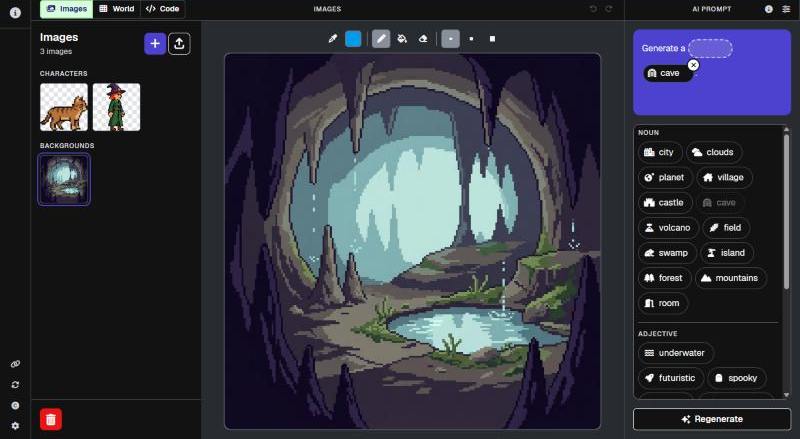
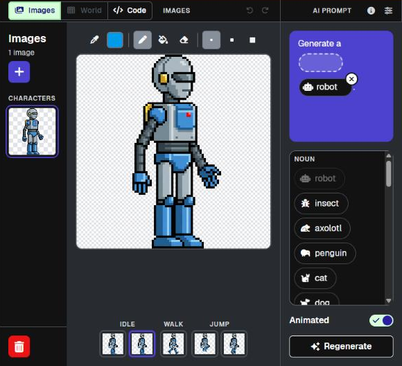
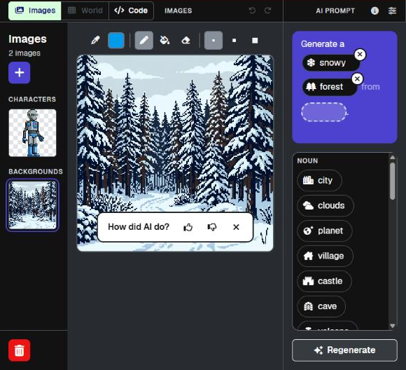
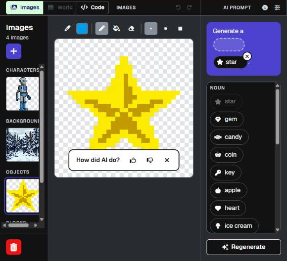
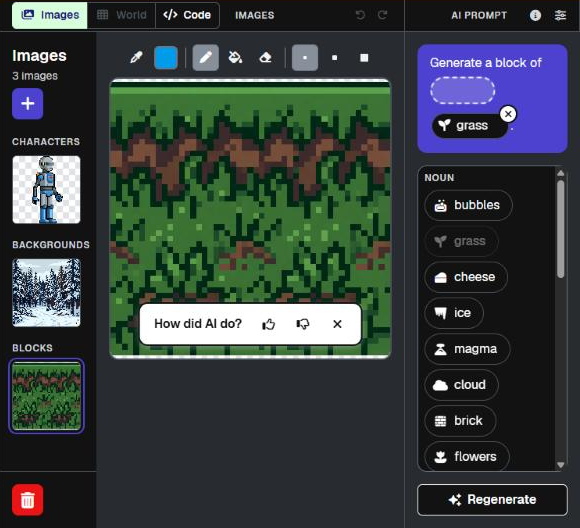
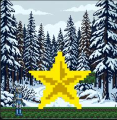
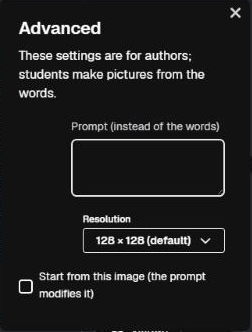

# Images tab and AI image creator Tested

The **Images** tab is where students (and you, in start mode) make the pictures a level uses: characters, backgrounds, objects and platform blocks. Each picture comes from the AI image creator, and students can paint on it afterwards. Tested 2026-11-25 in start mode; nothing was saved.

{ .screenshot }

## Turn it on

1. Set the [Kind](level-modes.md) to World, Image or Free play, or tick **Enable the Images tab** on a Code or Play level. On a Code level without it, the Images tab is greyed out.
2. Set **Image type** to limit what students make. With **Sprite**, only **Character** can be chosen from the **+** menu. Background, Object and Block are greyed out.
3. Leave **Image source** on **Cached**.

## The Images tab

{ .block }

- **Left:** the level's pictures, grouped as **Characters**, **Backgrounds**, **Objects** and **Blocks**. The **+** button adds one, and the red trash button deletes the selected one.
- **Middle:** the picture, with paint tools above it. Characters also show their **Idle**, **Walk** and **Jump** frames below it.
- **Right:** the **AI prompt** panel, where students build a sentence from word chips and click **Generate**.

In start mode, new pictures stay in the editor until you click **Save**, like code changes. The header says "Not saved" until then.

## Four kinds of picture

Each kind gets a different sentence and different word chips. The first chip is the noun; picking one shows the adjective (and extra) chips.

| Kind | Sentence | Nouns | Adjectives | Extra |
|---|---|---|---|---|
| Character | Generate a [adjective] [noun] … [accessory] | robot, insect, axolotl, penguin, cat, dog, unicorn, dumpling, blob, dragon, fox, witch | spooky, robotic, aquatic, magical, cute, grumpy, red, orange, green, blue, purple, pink | crown, boots, hat, glasses, cape |
| Background | Generate a [adjective] [noun] from [where] | city, clouds, planet, village, castle, cave, volcano, field, swamp, island, forest, mountains, room | underwater, futuristic, spooky, snowy, outer space, tropical, frozen, misty, overgrown, ancient, cheery, candy | inside, far away |
| Object | Generate a [adjective] [noun] | star, gem, candy, coin, key, apple, heart, ice cream, flower, gift, flame, potion, door | crystal, ancient, glowing, fiery, metallic, spiky | |
| Block | Generate a block of [adjective] [noun] | bubbles, grass, cheese, ice, magma, cloud, brick, flowers, candy, coral, stone, metal, jelly, wood | dark, crystal, magical, golden, electric, crumbling, overgrown, slimy | |

Only characters have the **Animated** toggle and Idle, Walk and Jump frames. Objects, backgrounds and blocks are one still picture.

<figure markdown>
{ .block }
<figcaption>Background</figcaption>
</figure>

<figure markdown>
{ .block }
<figcaption>Object</figcaption>
</figure>

<figure markdown>
{ .block }
<figcaption>Block</figcaption>
</figure>

## Where pictures show up in blocks

| Kind | Named | Use it in |
|---|---|---|
| Character | Sprite 1, Sprite 2, … | Any sprite menu: **make new sprite**, the sprite picker, **set as player**, **make platform player** |
| Object | Sprite 2, Sprite 3, … | The same sprite menus. Objects are sprites too. |
| Background | Background 1, … | **set background to** |
| Block | Block 1, … | **make platform blocks** |

Tested: a snowy forest background, grass platform blocks, a robot platform player and a star object all appeared in one game.

{ .block }

!!! tip "Use different images for touching"
    **when ? touches ?** fires right away if both slots name the same image. An object gives you a second image to test touching with. See [Blocks](reference/blocks.md#gamelab_checkTouching).

## Making a picture

1. Click **+** and pick a kind.
2. Click word chips to fill the sentence. Click the **×** on a chip to remove it.
3. Click **Generate**. It took about 10–15 seconds in the test. While it works, a tip says a longer prompt doesn't always make a better picture.
4. Rate it with **How did AI do?** (thumbs up or down), or change the words and click **Regenerate**. The same words can give a different picture.

### Behind the scenes and How AI made this

The **ⓘ** button by **AI prompt** opens **Behind the scenes**. It shows the full prompt sent to the AI: the student's words as the first sentence, then the text the lab always adds. For a background, the added text asks for crisp pixel art on a 128 × 128 grid, a scene with no people or creatures, no border, and no writing.

**How AI made this** is six short panels for students:

1. A background is a big job (backgrounds have many more pixels than the other kinds)
2. AI learned from examples
3. Your words guide the image
4. From noise to picture
5. Try another picture (Regenerate)
6. Evaluate the picture (thumbs up or down)

### Advanced settings (authors only)

{ .block }

The sliders button by **AI prompt** opens **Advanced**, marked "These settings are for authors; students make pictures from the words."

| Setting | What it does |
|---|---|
| Prompt (instead of the words) | Type your own prompt instead of using word chips. |
| Resolution | 128 × 128 (default), 64 × 64 or 32 × 32. |
| Start from this image | The prompt changes the current picture instead of starting over. |

## Paint tools

| Tool | Key |
|---|---|
| Eyedropper | I |
| Choose color | C |
| Pen | P |
| Fill | F |
| Eraser | E |
| Brush size 1, 2, 4 | 1, 2, 3 |

Undo and redo are at the top right of the tab. Students can also paint with the keyboard: the arrow keys move a paint cursor, and Space or Enter uses the tool.

## Level settings

| Setting | What it does |
|---|---|
| Image source | **Cached** uses the published set of pictures. **Live** asks the model every time, but only for levelbuilders. Students always get cached pictures. |
| Image upload | The editor labels it "FOR DEVELOPMENT USE ONLY, NOT FOR USER-FACING LEVELS." |
| Learning modal | Explains how AI made the picture, after the first generation only. |

The word lists and the hidden parts of the prompt are built into the lab. You can't change them for one level.
