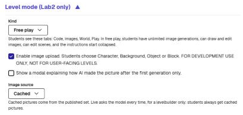

# Level modes Tested

A level's **Kind** decides which tabs students see. Set it in the **Level mode (Lab2 only)** section of the edit page, then click **Save and publish**.

{ .screenshot }

| Kind | Tabs students see | Settings it shows |
|---|---|---|
| None | Images, Code, Play (students can edit scenes) | None |
| Code | Code, Play | Enable the Images tab and start on it |
| Play | Play | Enable the Images tab and start on it |
| World | World, Play | Image type, Image role, Palette roles, Enable the Images tab |
| Image | Images | Image type, Image role, One image, Image upload, Learning modal, Image source |
| Free play | Code, Images, World, Play | Image upload, Learning modal, Image source |

## What changes with each setting

- **Free play** also gives students unlimited image generations, drawing tools, scene editing, and instructions that start collapsed.
- On a **World** level, ticking **Enable the Images tab** adds One image, Image upload, Learning modal and Image source.
- Setting **Image type** to **Sprite** adds **Image subject** (Character or Object).

!!! note "Check the student view"
    As a levelbuilder you may see a **Code** tab on a World level that the editor doesn't list. Check the level as a student before you rely on the tab list.

## Settings you can only set in JSON Not yet tested

These level mode settings exist in the lab's code but have no field in the editor yet: `extraTabs`, `startTab`, `noNewImages`, `noDeletingImages`, `limitedPaintTools`, `imageKinds`, `generationLimit`. Ask the Student Learning team before using them.
