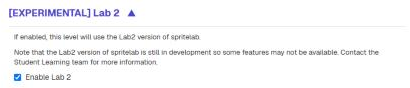

# Make a level Tested

There is no separate Sprite Lab 2 level type. You make a regular Sprite Lab level and switch it to Lab2.

1. Go to `https://levelbuilder-studio.code.org/levels/new`.
2. Click **Build a Sprite Lab Level**.
3. Type a **Name** and click **Save and publish**.
4. On the edit page, find the **[EXPERIMENTAL] Lab 2** section and tick **Enable Lab 2**.
   This box only appears after the first save.

    { .screenshot }

5. Click **Save and publish** again.

## Instructions

Long Instructions use Markdown. `## Title` and `### Subtitle` show as headings in the student's Instructions panel.

## Block pools

Keep the **GamelabJr** pool selected. The edit page notes that blocks Sprite Lab 2 doesn't support are left out of **start mode** and **toolbox mode**, the pages where you build the starter code and choose the toolbox. See [Starter code and toolbox](starter-code-and-toolbox.md).

!!! tip "Use your own test level"
    Try every change on a test level of your own before you touch a level that students or reviewers use.
