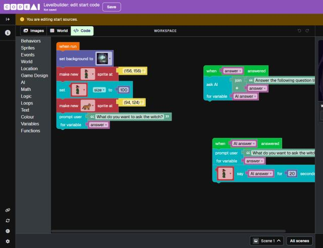

# Starter code and toolbox Tested

## Starter code

1. Open `/levels/{level ID}/edit_blocks/start_sources`.
2. Click the **Code** tab. The page says "You are editing start sources."

    { .screenshot }

3. Build the starter code. A new level starts with only `when run`, which students can't delete or move.

    { .block }
    { .block }

4. Click **Save** at the top of the page. The status changes from "Not saved" to "Saved".
5. Open the level and click **Start Over** to see your change.

!!! warning "Why you need Start Over"
    Once you have opened a level, Sprite Lab 2 loads your saved project instead of the new starter code. Students who already opened the level see their saved project too.

### Locking blocks Tested

Right-click a block and choose **Make Undeletable to Users**, **Make Immovable to Users** or **Make Uneditable to Users**. The change only saves after another edit: drag any block a little, wait about 5 seconds, then click **Save**.

Locking a function this way doesn't protect the blocks inside it; students can still drag them out. To lock a function so nothing inside can change, collapse it too. See [Lock a function](lock-a-function.md).

## Toolbox

1. Open `/levels/{level ID}/edit_blocks/toolbox_blocks`. The page says "You are editing toolbox blocks."
2. Open the **Categories** category and drag out a **Category** block. Type the category name, for example `Events`.

    { .block }
    { .block }

3. Place blocks from the other categories under it. Those blocks appear in that category for students.
4. For Variables or Functions, drag an **Auto-populated Category** block and choose Variables or Functions.

    { .block }
    { .block }

5. Click **Save**.

!!! warning "Don't make Variables twice"
    A Category block named "Variables" next to an Auto-populated Variables block gives students two Variables categories, and one of them is empty. Use the Auto-populated block on its own.

### The default toolbox

A new level's toolbox has these categories: Behaviors, Sprites, Events, World, Location, Game Design, AI, Math, Logic, Loops, Text, Colour, Variables, Functions.

### Block catalog Not yet tested

The `block_catalog`, `blocks_always_in_toolbox` and `lock_earlier_blocks` settings live in the [JSON properties](reference/json-properties.md) box.
